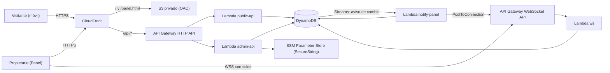
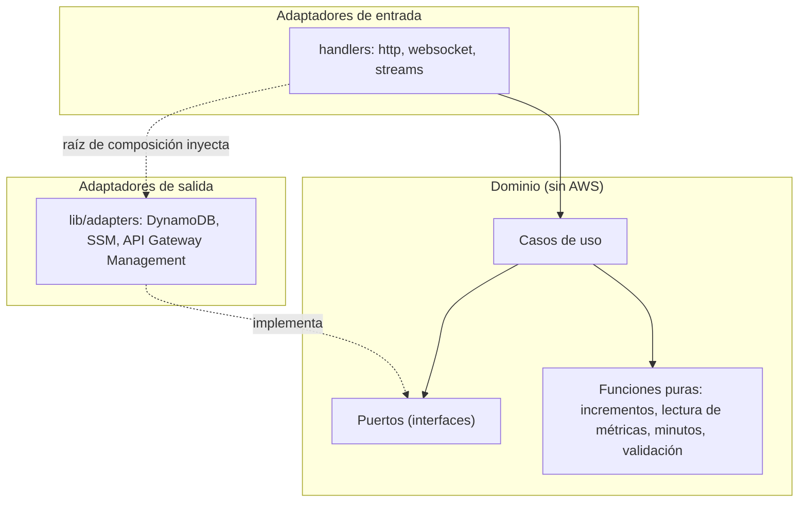
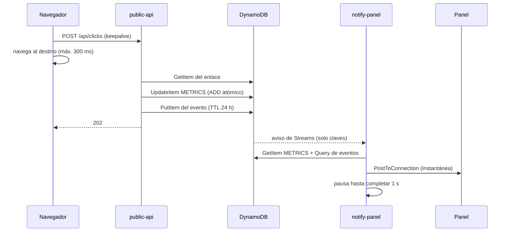
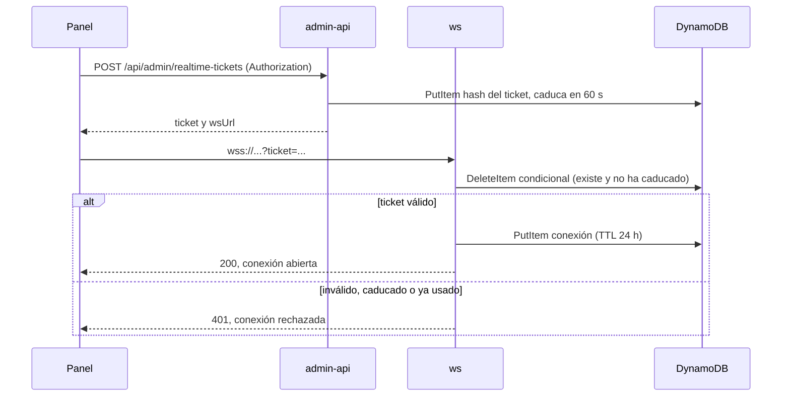

# Design Document

## Overview

Link in Bio es una aplicación serverless en AWS (región `eu-west-1`) con cuatro piezas: un frontend estático (página pública y Panel), una API HTTP, una API WebSocket y una tabla DynamoDB. Este documento explica cómo se cumplen los 17 requisitos de `requirements.md` y respeta el steering (`product.md`, `tech.md`, `structure.md`).

Es una versión "lite", pensada para una demo de nivel principiante a intermedio: pocas piezas, cada una con una función clara y sin mecanismos que solo hacen falta a gran escala.

Las ideas centrales del diseño son estas:

1. **Todos los contadores viven en un único elemento de DynamoDB** (`METRICS/CURRENT`). Un Clic ejecuta un solo `UpdateItem` con `ADD`, que es atómico: suma todos los contadores o no suma ninguno.
2. **El feed de actividad son elementos pequeños con TTL**, uno por evento. Guardarlos es de mejor esfuerzo: si falla, el Clic cuenta igual.
3. **DynamoDB Streams solo avisa de que algo ha cambiado.** Un procesador lee el estado actual y lo envía a los Paneles por WebSocket, como máximo una vez por segundo.
4. **Un único tipo de mensaje**: la instantánea (`snapshot`) con valores absolutos. Es el mismo formato que devuelve `GET /api/admin/metrics`. Como el Panel conserva siempre el valor mayor, un mensaje repetido o desordenado no falsea los números.
5. **Reiniciar métricas es reemplazar el elemento `METRICS/CURRENT`** por uno vacío con una época nueva. Es una sola operación atómica.
6. **Arquitectura hexagonal.** La lógica de dominio no conoce AWS. Los puertos son interfaces del dominio y los adaptadores de DynamoDB, SSM y API Gateway los implementan.

### Decisiones de diseño

Estas decisiones cierran los puntos que el steering dejó abiertos para la fase de diseño.

| Id | Decisión | Alternativa descartada | Motivo |
|---|---|---|---|
| D1 | Contadores en un único elemento, incrementados con un `UpdateItem` con `ADD` por Clic o Visita | Procesador de Streams que cuenta por lotes con marcas de idempotencia, o `TransactWriteItems` por Clic | Una operación atómica cumple 2.7 y 7.7 sin código extra. A 50 Clics por segundo el elemento recibe 50 escrituras por segundo, por debajo del límite de 1 000 por segundo de una partición. Los contadores son atributos de primer nivel (`l#<id>`, `cc#<canal>`, `m#<minuto>`), así que no hay que inicializar mapas |
| D2 | Tabla única `LinkInBioTable` con claves `pk`/`sk` | Varias tablas | Un solo recurso que crear y conceder. Solo hay 5 tipos de elemento |
| D3 | CloudFront sirve la API en `/api/*` (mismo origen) | API en su propio dominio con CORS | El navegador solo habla con un dominio (11.4). No hace falta CORS y las peticiones `keepalive` del Clic no necesitan preflight |
| D4 | El WebSocket se abre directamente contra API Gateway, sin pasar por CloudFront | WebSocket detrás de CloudFront | Evita límites de tiempo de CloudFront sobre conexiones inactivas. La CSP del Panel permite ese único `wss://` |
| D5 | El Ticket_Conexión viaja en el parámetro `ticket` de la URL del WebSocket | Token en la URL, o subprotocolo | El ticket es de un solo uso y caduca a los 60 s. El Token_Propietario nunca aparece en una URL (5.1, 5.10) |
| D6 | Zod para los esquemas de `shared/` | Valibot, validación a mano | Es la candidata del steering, con inferencia de tipos para que el frontend y el backend compartan un único contrato |
| D7 | Un único stack de CDK con constructs por área (`Storage`, `Api`, `Realtime`, `Frontend`) | Un stack por área | Un solo `cdk deploy` y sin exportaciones entre stacks. La demo se puede destruir y recrear |
| D8 | Streams solo como aviso: vista `KEYS_ONLY`, filtro por `METRICS` y `EVENTS`, sin ventana de agrupación y con una pausa de 1 s al final de cada invocación | Procesador que cuenta, o ventana de agrupación de 1 s | Un shard se procesa de forma secuencial, así que la pausa garantiza al menos 1 s entre envíos (8.7) con tres líneas de código. Los registros de solo claves son diminutos y el primer Clic tras un silencio sale al instante |
| D9 | Throttling por ruta en la HTTP API: 150 req/s (ráfaga 300) para `POST /api/clicks` y 50 req/s (ráfaga 100) para `POST /api/visits` | Límite por IP | La suma es 200 req/s con ráfaga de 400 (12.8). No se limita por IP porque el público comparte la Wi-Fi del recinto (12.9) |
| D10 | Frontend en TypeScript sin framework. El estado del Panel es un reductor puro | React u otro framework | El steering pide evitar frameworks pesados. El reductor puro se prueba con tests basados en propiedades |
| D11 | Los adaptadores de salida que usan el SDK de AWS (DynamoDB, SSM, API Gateway Management) viven en `backend/src/lib/adapters/` | Llamar a la carpeta `repositories/` | SSM y API Gateway no son repositorios. `structure.md` ya usa el nombre nuevo |
| D12 | Canales cerrados: 10 Canales_Predefinidos fijos en `shared/`. Sin `src` es `directo` y cualquier otro valor es `otro`. Los canales personalizados quedan para un spec posterior | Canales personalizados en la primera versión | Acota los contadores a 12 canales y reduce el alcance. Ver "Extensión prevista" |
| D13 | La API decide el Canal_Origen. La página solo envía el Valor_Canal | Normalizar en la página | La normalización vive en un solo sitio, y la página no necesita conocer la lista de canales |
| D14 | Plazo de tiempo real de 1 a 3 s: objetivo habitual de 1 s y máximo de 3 s (8.1, 8.2) | Máximo de 2 s | Da margen a la latencia de Streams y a la pausa de 1 s sin perder la sensación de directo |
| D15 | Dependencias nuevas: `zod` (producción, en `shared/`) y `fast-check` (desarrollo). `aws-sdk-client-mock` y `happy-dom` están aprobadas pero solo se instalan si hacen falta | Instalar las cuatro desde el principio | Menos dependencias que aprender. Las funciones puras se prueban sin simular el SDK ni el DOM |
| D16 | El Panel se sirve en `/panel.html` y la URL del WebSocket viaja en la respuesta del ticket | `/panel/` con una CloudFront Function y un `config.json` generado | Elimina una CloudFront Function y un archivo generado al desplegar |
| D17 | La época es la marca de tiempo (ms) del último reinicio, y 0 si nunca se ha reiniciado | Contador entero que aumenta de 1 en 1 | No hace falta leer antes de reiniciar. Además sirve de límite inferior para leer los eventos del feed |

## Architecture

### Vista general



### Capas y regla de dependencias



La regla es que las dependencias apuntan hacia el dominio. El dominio no importa nada de `@aws-sdk/*`, de `handlers/` ni de `adapters/`.

| Principio | Cómo se aplica |
|---|---|
| Responsabilidad única | Un caso de uso por archivo (`register-click.ts`, `reset-metrics.ts`, ...). Los handlers solo parsean, llaman y devuelven |
| Abierto/cerrado | Cambiar de DynamoDB a otro almacén es escribir otro adaptador. Los casos de uso no cambian |
| Sustitución de Liskov | Los dobles en memoria y los adaptadores de DynamoDB cumplen el mismo contrato de cada puerto |
| Segregación de interfaces | Puertos pequeños por necesidad (`LinkRepository`, `MetricsRepository`, ...) en lugar de un repositorio genérico |
| Inversión de dependencias | Los casos de uso reciben los puertos por parámetro. Cada handler tiene una raíz de composición (`compose-*.ts`) que crea los adaptadores reales |

### Flujo de un Clic



### Flujo de conexión del Panel




## Components and Interfaces

### Estructura del código

```
shared/src/
  channel.ts              # PREDEFINED_CHANNELS, normalizeChannel, compareChannels (puro)
  link-rules.ts           # validateTitle, validateUrl (puro)
  schemas.ts              # esquemas Zod de peticiones y respuestas
  realtime.ts             # MetricsSnapshot, RealtimeMessage, serialize, parse
backend/src/
  handlers/
    http/public-api.ts    # GET /api/links, POST /api/visits, POST /api/clicks
    http/admin-api.ts     # rutas /api/admin/*
    websocket/ws.ts       # $connect, $disconnect y $default
    streams/notify-panel.ts
  lib/
    domain/               # casos de uso, puertos y funciones puras
    adapters/             # adaptadores de salida: DynamoDB, SSM, API Gateway Management
    http/                 # canalización común de HTTP (tamaño, token, esquema)
    compose-*.ts          # raíces de composición de cada handler
frontend/src/
  public/                 # página pública (index.html y main.ts)
  dashboard/              # Panel (panel.html, store, vistas)
  lib/                    # cliente de la API, cliente WebSocket con reconexión
infra/lib/                # constructs: storage, api, realtime, frontend
```

### Contratos compartidos (`shared/`)

`shared/` contiene TypeScript puro y Zod. No usa Node, DOM ni AWS. Exporta funciones sueltas para que la página pública incluya solo los tipos y las constantes, sin cargar Zod.

| Contrato | Descripción | Requisitos |
|---|---|---|
| `PREDEFINED_CHANNELS` | Lista fija: `qr`, `instagram`, `tiktok`, `x`, `facebook`, `linkedin`, `youtube`, `whatsapp`, `telegram`, `github` | Glosario |
| `normalizeChannel(value)` | Sin valor o vacío devuelve `directo`. Si no, convierte solo A-Z a minúsculas y devuelve el resultado si es un Canal_Predefinido, `directo` u `otro`. En cualquier otro caso devuelve `otro`. Solo la usa la API | 4.2 a 4.5, 4.7 |
| `compareChannels(a, b)` | Orden de canales por Clics descendente y, en empate, por nombre ascendente | 7.4, 8.3 |
| `validateTitle(raw)` | Tras `trim`, 1 a 80 puntos de código, sin caracteres de control (`\p{Cc}`) ni de control bidireccional (U+202A a U+202E, U+2066 a U+2069) | 6.6 |
| `validateUrl(raw)` | URL `http` o `https`, host no vacío, sin usuario ni contraseña, sin espacios ni caracteres de control, de 1 a 2048 caracteres | 6.7 |
| `ClickRequest`, `VisitRequest` | `{ linkId: uuid, channel?: string(max 256) }` y `{ channel?: string(max 256) }`. El canal se normaliza después de validar el esquema | 14.3, 4.4 |
| `CreateLinkRequest`, `UpdateLinkRequest`, `ReorderRequest` | `{ title, url }`, `{ title?, url?, active? }` (al menos un campo) y `{ ids: uuid[] }` | 6 |
| `PublicLinksResponse`, `AdminLinksResponse`, `TicketResponse` | Respuestas de la API. `TicketResponse` es `{ ticket, expiresAt, wsUrl }` | 1, 5, 6 |
| `MetricsSnapshot` | Instantánea de las Métricas. La devuelve `GET /api/admin/metrics` y la envía el WebSocket | 7, 8, 16 |
| `RealtimeMessage` | `{ type: 'snapshot' } & MetricsSnapshot`. Incluye `serialize` y `parse` con error descriptivo | 14.6 a 14.10, 8 |
| `KeepaliveMessage` | `{ "type": "keepalive" }`, el único mensaje que acepta el servidor | 8.13, 8.14 |

Forma de la instantánea:

```ts
interface MetricsSnapshot {
  epoch: number; // 0 hasta el primer reinicio; después, la hora (ms) del último reinicio
  serverTime: string; // ISO 8601 UTC, para corregir el reloj del Panel
  totals: { clicks: number; visits: number };
  links: Record<string, number>; // linkId -> Clics
  minutes: Record<string, number>; // inicio del Minuto (ISO) -> Clics; solo Minutos con Clics de los últimos 60
  channels: Record<string, { clicks: number; visits: number }>;
  events: ActivityEvent[]; // hasta 20, del más reciente al más antiguo
}

interface ActivityEvent {
  id: string; // identificador técnico aleatorio
  type: 'click' | 'visit';
  title?: string; // solo en Clics
  channel: string;
  at: string; // ISO 8601 UTC
}
```

La instantánea no lleva títulos de Enlaces. El Panel los obtiene de `GET /api/admin/links` y los une por identificador (7.1).

### Dominio (`backend/src/lib/domain/`)

#### Puertos

| Puerto | Operaciones | Implementación real |
|---|---|---|
| `LinkRepository` | `list()`, `get(id)`, `create(link)`, `update(id, patch)`, `remove(id)`, `reorder(ids)` | DynamoDB |
| `MetricsRepository` | `recordClick(linkId, channel, minute)`, `recordVisit(channel)`, `read()`, `reset(now)`, `removeLinkCounter(linkId)` | DynamoDB |
| `EventRepository` | `put(event)`, `latest(since, limit)` | DynamoDB |
| `RealtimeAccessRepository` | `storeTicket(hash, expiresAt)`, `consumeTicket(hash, now)`, `addConnection(conn)`, `removeConnection(id)`, `listConnections(now)` | DynamoDB |
| `OwnerTokenProvider` | `getToken()` | SSM Parameter Store |
| `RealtimeNotifier` | `send(connectionId, payload)` devuelve `sent` o `gone` | API Gateway Management API |
| `Clock`, `IdGenerator`, `RandomSource` | Hora actual, UUID y bytes aleatorios | Implementaciones de Node |

#### Casos de uso

| Caso de uso | Puertos | Comportamiento | Requisitos |
|---|---|---|---|
| `listPublicLinks` | `LinkRepository` | Enlaces activos ordenados por posición | 1.1, 1.3 |
| `registerClick` | `LinkRepository`, `MetricsRepository`, `EventRepository`, `Clock`, `IdGenerator` | Lee el Enlace (si no existe o está inactivo lanza `NotFound`), normaliza el canal e incrementa los contadores con una sola operación. Después guarda el Evento con el título vigente. Si guardar el Evento falla, lo registra y responde con éxito igualmente | 2.5 a 2.7, 4.2 a 4.5, 9.3 |
| `registerVisit` | `MetricsRepository`, `EventRepository`, `Clock`, `IdGenerator` | Igual que el Clic, con los contadores de Visitas | 3.2, 4.2 a 4.5 |
| `createLink`, `updateLink`, `reorderLinks` | `LinkRepository` | Aplican las reglas de 6. `createLink` cuenta los Enlaces existentes (máximo 10) y asigna la posición siguiente a la mayor existente. `reorderLinks` exige una permutación exacta de los identificadores existentes | 6.1 a 6.13 |
| `removeLink` | `LinkRepository`, `MetricsRepository` | Elimina el Enlace y su contador `l#<id>`. El total, los Minutos y los canales no cambian. Si borrar el contador falla, lo registra: el Enlace ya no existe y `getMetrics` solo muestra los existentes | 6.5 |
| `getMetrics` | `MetricsRepository`, `EventRepository`, `Clock` | Lee el elemento de métricas, los últimos 20 eventos de la época en curso y construye la `MetricsSnapshot` con `parseMetricsItem`. Lo usan la API y el notificador | 7.1 a 7.7, 8.8 |
| `resetMetrics` | `MetricsRepository`, `Clock` | Sustituye el elemento de métricas por uno vacío con la época nueva | 16.3, 16.7, 16.8 |
| `issueTicket` | `RealtimeAccessRepository`, `RandomSource`, `Clock` | Genera 32 bytes aleatorios, guarda solo el hash SHA-256 y devuelve el ticket con su caducidad (60 s) | 5.15, 5.17 |
| `openConnection` | `RealtimeAccessRepository`, `Clock` | Consume el ticket de forma atómica. Si es válido, guarda la Conexión con caducidad de 24 h | 5.7, 5.16, 11.5, 11.6 |
| `closeConnection` | `RealtimeAccessRepository` | Elimina la Conexión | 11.7 |
| `authorizeOwner` | `OwnerTokenProvider` | Falla con `ServerMisconfigured` si el token tiene menos de 32 caracteres. Compara el hash SHA-256 del token recibido con el del Token_Propietario usando `timingSafeEqual` | 5.3 a 5.5 |
| `notifyPanels` | `getMetrics`, `RealtimeAccessRepository`, `RealtimeNotifier` | Construye la instantánea y la envía a todas las Conexiones. Ver más abajo | 8.1, 8.2, 12.6, 12.7, 16.5 |

#### Funciones puras

| Función | Descripción |
|---|---|
| `minuteStart(ts)` | Inicio del Minuto UTC (segundos desde la época Unix) al que pertenece `ts` |
| `lastMinutes(now, 60)` | Los 60 Minutos consecutivos que terminan en el actual |
| `buildClickIncrement(linkId, channel, minute)` y `buildVisitIncrement(channel)` | Devuelven los nombres de atributo que hay que sumar 1 en el elemento de métricas. Los usa el adaptador para construir la expresión `ADD` |
| `parseMetricsItem(item, now)` | Convierte los atributos del elemento de métricas en totales, Clics por Enlace, por canal y por Minuto (solo los últimos 60), ignorando los atributos desconocidos |

Un Clic suma 4 atributos y una Visita suma 2, todos en el mismo `UpdateItem`:

```
Clic:   ADD totalClicks 1, l#<linkId> 1, cc#<canal> 1, m#<inicio del Minuto> 1
Visita: ADD totalVisits 1, cv#<canal> 1
```

### API HTTP

Todas las rutas cuelgan de `/api` y CloudFront las reenvía sin cachear. Todas las respuestas llevan `Cache-Control: no-store` (17.3). La API no devuelve cabeceras CORS: el navegador solo la usa desde el mismo origen y un origen distinto no puede leer la respuesta (14.5).

| Ruta | Auth | Petición | Respuesta | Errores |
|---|---|---|---|---|
| `GET /api/links` | No | n/a | `200 { links: [{ id, title, url }] }` | 500 |
| `POST /api/visits` | No | `{ channel? }` | `202 {}` | 400, 429, 500 |
| `POST /api/clicks` | No | `{ linkId, channel? }` | `202 {}` | 400, 404, 429, 500 |
| `POST /api/admin/realtime-tickets` | Token | n/a | `200 { ticket, expiresAt, wsUrl }` | 401, 500 |
| `GET /api/admin/metrics` | Token | n/a | `200 MetricsSnapshot` | 401, 500 |
| `POST /api/admin/metrics/reset` | Token | n/a | `200 { epoch }` | 401, 500 |
| `GET /api/admin/links` | Token | n/a | `200 { links: AdminLink[] }` | 401, 500 |
| `POST /api/admin/links` | Token | `{ title, url }` | `201 AdminLink` | 400, 401, 409 |
| `PATCH /api/admin/links/{id}` | Token | `{ title?, url?, active? }` | `200 AdminLink` | 400, 401, 404 |
| `DELETE /api/admin/links/{id}` | Token | n/a | `204` | 401, 404 |
| `PUT /api/admin/links/order` | Token | `{ ids }` | `200 { links }` | 400, 401 |

#### Canalización común (`lib/http/`)

Todos los handlers usan la misma canalización, en este orden (5.6, 14.1):

1. **Tamaño:** si el cuerpo supera 10 240 bytes, responde 400 con `reason: payload_too_large` sin procesarlo.
2. **Autenticación** (solo rutas de administración): `authorizeOwner` con el token de la cabecera `Authorization: Bearer`. Si falla, responde 401 sin mirar el cuerpo.
3. **JSON:** si el cuerpo no es JSON válido, responde 400.
4. **Esquema:** valida cuerpo, parámetros de ruta y de consulta con Zod. Si falla, responde 400 con la lista de campos no válidos.
5. **Caso de uso:** llama al dominio y traduce sus errores a códigos HTTP.

Una petición sin token válido nunca llega al paso del esquema, así que un anónimo no puede descubrir el formato de la API de administración.

### API WebSocket

Una sola Lambda (`ws`) atiende las tres rutas y decide por `routeKey`.

| Ruta | Comportamiento |
|---|---|
| `$connect` | Lee `ticket` de la consulta y llama a `openConnection`. Devuelve 200 si se acepta y 401 si se rechaza |
| `$disconnect` | Llama a `closeConnection` |
| `$default` | Descarta todo mensaje que no sea `{"type":"keepalive"}` o que supere 128 bytes. No responde ni reenvía nada |

El Panel envía un `keepalive` cada 5 minutos. API Gateway cierra una conexión WebSocket tras 10 minutos sin tráfico, y este mensaje evita ese cierre durante una charla sin clics.

### Notificador (`streams/notify-panel.ts`)

El mapeo de origen de eventos usa la vista `KEYS_ONLY` del stream y un filtro que deja pasar solo las altas y modificaciones de los elementos `METRICS` y `EVENTS`. Los borrados por TTL y los cambios de Enlaces, conexiones y tickets no lo activan.

Algoritmo de `notifyPanels`:

1. Construye la instantánea con `getMetrics`. El contenido de los registros del stream no se usa: solo sirven de aviso.
2. Lista las Conexiones no caducadas.
3. Envía el mensaje `snapshot` a todas con concurrencia limitada.
   - Si el envío falla con `gone` (410), elimina la Conexión (12.7).
   - Si falla por otro motivo, lo registra y continúa con el resto (12.6).
4. Espera hasta que hayan pasado 1 s desde el inicio de la invocación y termina.

Un shard se procesa de forma secuencial (`ParallelizationFactor` 1). Por eso la pausa final garantiza al menos 1 s entre dos envíos (8.7), y mientras tanto el stream va acumulando los avisos, que la siguiente invocación resuelve con una sola instantánea. Esta garantía asume un único shard, que es lo habitual con este tráfico (riesgo R2).

El mapeo de origen usa `startingPosition: LATEST`, `retryAttempts: 1`, `maxRecordAge: 60 s` y `bisectBatchOnError: false`. Una instantánea antigua no sirve de nada, y el Panel se resincroniza solo cada 30 s (8.12).

Presupuesto de latencia de un Clic hasta el Panel (D14):

| Tramo | Habitual | Peor caso |
|---|---|---|
| `UpdateItem` hasta que Lambda recibe el aviso | 0,25 a 0,5 s | 1 s |
| Espera por la pausa de la invocación anterior | 0 a 0,5 s | 1 s |
| Lectura de métricas y eventos | 0,05 a 0,1 s | 0,3 s |
| `PostToConnection` hasta el navegador | 0,05 a 0,1 s | 0,3 s |
| **Total** | **entre 0,5 y 1,5 s** | **menos de 3 s** |

La prueba de carga mide este tiempo de punta a punta y debe dar un p95 inferior a 3 s.

### Frontend: página pública (`frontend/src/public/`)

Vite genera una página multipágina: `index.html` (pública) y `panel.html` (Panel). La página pública no usa framework, no crea cookies ni escribe en `localStorage` o `sessionStorage` (11.3).

| Módulo | Responsabilidad |
|---|---|
| `channel.ts` | Lee el primer valor de `src` con `URLSearchParams.get`, lo recorta a 256 caracteres y lo envía sin normalizar como Valor_Canal. `URLSearchParams` no lanza excepciones con una codificación inválida (4.1, 4.6, 4.8, 4.9) |
| `links-view.ts` | Pinta los estados de carga, lista, vacío y error. Usa solo `textContent` y `createElement`, nunca `innerHTML` (14.9) |
| `click.ts` | Gestiona la activación de un Enlace |
| `visit.ts` | Envía la Visita una vez cuando la lista se carga bien |
| `main.ts` | Orquesta la carga, el botón "Reintentar" y el orden de las acciones |

Comportamiento clave:

- **Carga:** `GET /api/links` con `AbortController` a 5 s. Se muestra "Cargando enlaces…" en una región con `role="status"` mientras espera.
- **Visita:** se envía justo después de pintar la lista, sin esperar la respuesta (3.5), con un límite de 5 s y sin reintento. Una restauración desde la caché de navegación no ejecuta el script otra vez, así que no cuenta una Visita nueva (3.6).
- **Clic principal (toque, botón principal o Intro):** el manejador llama a `preventDefault`, envía `fetch('/api/clicks', { method: 'POST', keepalive: true })` y ejecuta `location.assign(url)` de inmediato, sin esperar la respuesta (2.1, 2.2, 2.4). El envío con `keepalive` continúa aunque la página se descarte.
- **Botón central y Ctrl/Cmd + clic:** envía el Clic igual, pero no llama a `preventDefault`, de modo que el navegador abre la pestaña nueva (2.3).
- **Accesibilidad:** HTML semántico (`main`, `h1`, `ul`), `lang="es"`, área táctil mínima de 44 × 44 px, contraste de 4,5:1, foco visible con contraste de 3:1, y `overflow-wrap: anywhere` en los títulos para que uno de 80 caracteres sin espacios no cause desplazamiento horizontal (13).

### Frontend: Panel (`frontend/src/dashboard/`)

| Módulo | Responsabilidad |
|---|---|
| `auth.ts` | Elimina los espacios iniciales y finales del token escrito, lo guarda como Token_Guardado en `sessionStorage` y lo borra al cerrar sesión o ante un 401 (5.1, 5.8, 5.10, 5.11) |
| `api.ts` | Cliente con límite de 5 s. Envía el token en `Authorization`, nunca en la URL |
| `store.ts` | Reductor puro `DashboardState` con `applySnapshot` y `advanceClock` |
| `realtime.ts` | Cliente WebSocket con reconexión (ver más abajo) |
| `announcer.ts` | Región `aria-live="polite"` que resume la actividad como máximo cada 10 s (9.4) |
| `views/` | Formulario de acceso, lista de Enlaces con subir/bajar, métricas, canales, feed, gráfica y diálogos de confirmación |

```ts
interface DashboardState {
  epoch: number;
  clockOffsetMs: number; // serverTime - Date.now() al recibir una instantánea
  totals: { clicks: number; visits: number };
  links: Map<string, number>; // linkId -> Clics
  minutes: Map<number, number>; // inicio del Minuto (segundos Unix) -> Clics
  channels: Map<string, { clicks: number; visits: number }>;
  events: ActivityEvent[]; // como máximo 20, del más reciente al más antiguo
}
```

Hay una sola entrada de datos: `applySnapshot(state, snapshot)`. Se usa igual con la respuesta de `GET /api/admin/metrics` y con los mensajes del WebSocket. Reglas (todas puras y probadas con propiedades):

- **Épocas:** una instantánea de una época menor se descarta entera. Una de una época mayor sustituye el estado, que es lo que produce un reinicio (16.6, 8.6).
- **Máximo:** dentro de la misma época, cada contador pasa a `max(actual, recibido)`. Un valor menor se ignora y el resto se aplica (8.5).
- **Ventana de 60 Minutos:** se calcula con la hora del servidor corregida con `clockOffsetMs`. Un Minuto anterior a la ventana se ignora (8.9). Un Minuto posterior hace avanzar la ventana (8.10). Cada cambio de Minuto añade una barra a 0 y retira la más antigua (8.4).
- **Feed:** se unen los eventos nuevos con los existentes, se eliminan duplicados por `id`, se ordenan por hora descendente y se conservan 20 (9.1, 9.2).
- **Canales:** se ordenan con `compareChannels` tras cada cambio (8.3).
- **Enlace desconocido:** si una instantánea incluye un Enlace que el Panel no muestra, el Panel vuelve a pedir la lista de Enlaces y las Métricas, como máximo una vez cada 5 s, y después ignora los identificadores que sigan sin existir (8.11).
- **Mensajes no válidos:** `parse` los rechaza antes de llegar al reductor y el estado no cambia (8.6).

El cliente WebSocket (`realtime.ts`) funciona así:

- Antes de cada intento pide un ticket a la API (límite de 5 s) y abre `<wsUrl>?ticket=...`.
- Con un 401 al pedir el ticket, detiene los reintentos, borra el token y vuelve al formulario (10.5). Cualquier otro fallo cuenta como un intento fallido (10.8).
- Espera `min(2^n × 1 s, 30 s)` entre intentos (1, 2, 4, 8, 16, 30, 30, ...) y la reinicia a 1 s al abrir (10.1, 10.4).
- Muestra "Conectando…" en la primera conexión y "Reconectando…" en las siguientes, antes de 1 s (10.2).
- Al abrir, pide las Métricas y, si falla, repite cada 5 s (10.3, 10.6). Mientras la conexión está abierta, las vuelve a pedir cada 30 s (8.12).
- Envía el `keepalive` cada 5 minutos (8.13).
- "Cerrar sesión" cancela los reintentos, cierra la conexión y borra el token (10.7).

Accesibilidad del Panel: la gráfica es un SVG con `role="img"` y una tabla de texto equivalente, con los 60 Minutos y la hora de inicio de cada uno en la zona horaria del navegador (15.2). Los diálogos de confirmación usan `<dialog>` con `showModal()` y el foco inicial en "Cancelar". Todas las acciones de gestión tienen un botón y no dependen de arrastrar (15.1). `prefers-reduced-motion` desactiva las animaciones (15.6).

### Infraestructura (`infra/`)

Un único stack con cuatro constructs.

| Construct | Recursos |
|---|---|
| `Storage` | Tabla DynamoDB `PAY_PER_REQUEST`, atributo TTL `ttl`, stream `KEYS_ONLY`, política de eliminación `DESTROY` para la demo |
| `Api` | HTTP API con las rutas anteriores y throttling por ruta. Lambdas `public-api` y `admin-api` |
| `Realtime` | WebSocket API (etapa `prod`) con registro de acceso y de ejecución desactivados. Lambdas `ws` y `notify-panel` con su mapeo de origen filtrado |
| `Frontend` | Bucket S3 privado, distribución CloudFront con OAC, despliegue de `frontend/dist` y dos políticas de cabeceras |

Detalles que cumplen requisitos concretos:

- **Lambdas:** `NodejsFunction`, runtime `nodejs24.x`, ARM64, 512 MB, esbuild con minificación. Los registros se limitan a eventos con campos permitidos: nunca el cuerpo, las cabeceras ni el token (5.18, 11.2).
- **CloudFront:** `viewerProtocolPolicy: REDIRECT_TO_HTTPS` (17.1). Los registros de acceso están desactivados para no guardar IPs (11.2).
- **Comportamientos de CloudFront:**
  - `/api/*`: origen HTTP API, `CACHING_DISABLED`, `ALL_VIEWER_EXCEPT_HOST_HEADER` y todos los métodos.
  - `/panel.html`: origen S3 y política de cabeceras del Panel.
  - Resto: origen S3 y política de cabeceras pública.
- **Caché de estáticos:** los archivos con hash en `assets/` llevan `max-age` largo e `immutable`. Los HTML llevan `no-cache` para revalidar.
- **Cabeceras (17.2, 17.4):** ambas políticas añaden `Strict-Transport-Security`, `X-Content-Type-Options: nosniff` y `Referrer-Policy: strict-origin-when-cross-origin`. La del Panel añade `X-Robots-Tag: noindex`.
  - Página pública: `default-src 'self'; script-src 'self'; style-src 'self'; img-src 'self' data:; connect-src 'self'; frame-ancestors 'none'; base-uri 'none'; form-action 'self'`.
  - Panel: igual, pero con `connect-src 'self' wss://<id de la API WebSocket>.execute-api.eu-west-1.amazonaws.com`.
- **Token del propietario:** parámetro SSM `/link-in-bio/owner-token` de tipo `SecureString`. CloudFormation no puede crear `SecureString`, así que se crea una vez con la CLI (`aws ssm put-parameter`), con un valor de al menos 32 caracteres aleatorios. CDK solo lo referencia y concede lectura a `admin-api`.
- **URL del WebSocket:** `admin-api` la recibe en una variable de entorno y la devuelve junto con el ticket.

#### Permisos IAM (mínimo privilegio)

Se conceden con `table.grant(fn, ...acciones)` y con los `grant*` de CDK, nunca con `*`.

| Lambda | Acciones de DynamoDB | Otros permisos |
|---|---|---|
| `public-api` | `GetItem`, `Query`, `UpdateItem`, `PutItem` | Ninguno |
| `admin-api` | `GetItem`, `Query`, `PutItem`, `UpdateItem`, `DeleteItem` | Lectura del parámetro SSM del token |
| `ws` | `PutItem`, `DeleteItem` | Ninguno |
| `notify-panel` | `GetItem`, `Query`, `DeleteItem` (más lectura del stream) | `execute-api:ManageConnections` sobre el recurso `@connections/*` de la etapa |

## Data Models

### Tabla `LinkInBioTable`

Una sola tabla con clave de partición `pk` y clave de ordenación `sk` (ambas cadenas). El atributo `ttl` (segundos Unix) activa el borrado automático de DynamoDB. Hay 5 tipos de elemento.

| `pk` | `sk` | Atributos | `ttl` | Uso |
|---|---|---|---|---|
| `LINKS` | `LINK#<id>` | `id`, `title`, `url`, `position`, `active`, `createdAt` | No | Enlaces (como máximo 10) |
| `METRICS` | `CURRENT` | `epoch`, `totalClicks`, `totalVisits`, `l#<linkId>`, `cc#<canal>`, `cv#<canal>`, `m#<inicio del Minuto, segundos Unix>` | No | Todos los contadores de la época en curso |
| `EVENTS` | `<ts en ms, 13 dígitos>#<id>` | `id`, `type`, `channel`, `title` (solo Clic), `ts` | `ts` + 24 h | Entrada del Feed_Actividad |
| `CONN` | `<connectionId>` | `connectionId`, `createdAt` | `createdAt` + 24 h | Conexiones del Panel |
| `TICKET` | `<SHA-256 del ticket, hex>` | `expiresAt` | `expiresAt` + 1 h | Tickets_Conexión pendientes de uso |

Atributos del elemento `METRICS/CURRENT`:

| Atributo | Significado |
|---|---|
| `epoch` | Hora (ms) del último reinicio. Si falta, la época es 0 |
| `totalClicks`, `totalVisits` | Contadores totales |
| `l#<linkId>` | Clics de un Enlace |
| `cc#<canal>` | Clics de un Canal_Origen |
| `cv#<canal>` | Visitas de un Canal_Origen |
| `m#<inicio del Minuto>` | Clics de un Minuto UTC |

Decisiones sobre el modelo:

- **Un `ADD` sobre un atributo que no existe lo crea con el valor sumado.** Por eso los contadores son atributos de primer nivel con el nombre construido en tiempo de ejecución. No hay que inicializar el elemento ni mapas anidados, y un `UpdateItem` sobre un elemento que no existe lo crea.
- **Reiniciar es reemplazar el elemento.** `reset` hace un `PutItem` de `{ pk: 'METRICS', sk: 'CURRENT', epoch: <ahora> }`, que borra de golpe todos los contadores. Los eventos anteriores se descartan porque `latest` solo lee los eventos con `sk` mayor o igual que la época (16.3, 16.8).
- **El borrado de un Enlace no toca el total ni los canales.** Se elimina `LINKS/LINK#<id>` y el atributo `l#<id>`. El total, los Minutos y los canales conservan los Clics (6.5).
- **Los eventos se leen con un límite de edad.** `latest` usa `sk` mayor que la mayor de estas dos horas: ahora menos 24 h y la época. Un evento caducado no se devuelve aunque DynamoDB aún no lo haya borrado (11.8). Las Conexiones se filtran por `ttl > ahora` por el mismo motivo (11.6).
- **Privacidad por construcción.** Los únicos atributos de un Evento son los de la tabla. No existe ningún campo para IP, User-Agent ni Referer, y el caso de uso ni siquiera los recibe (11.1, 11.2).
- **Canales acotados.** Solo existen atributos `cc#` y `cv#` para los 10 Canales_Predefinidos, `directo` y `otro`: como máximo 12 canales (D12).

### Patrones de acceso

| Patrón | Operación | Lectura consistente |
|---|---|---|
| Lista de Enlaces (pública y administración) y cuenta para el máximo de 10 | `Query pk = LINKS` | Sí |
| Un Enlace | `GetItem LINKS/LINK#id` | Sí |
| Crear un Enlace | `PutItem` con condición `attribute_not_exists(pk)`, tras comprobar que hay menos de 10 | n/a |
| Reordenar | `TransactWriteItems` con un `Update position` por Enlace, cada uno condicionado a que exista | n/a |
| Registrar un Clic o una Visita | `UpdateItem METRICS/CURRENT` con `ADD` | n/a |
| Guardar un Evento | `PutItem` en `EVENTS` | n/a |
| Leer las Métricas | `GetItem METRICS/CURRENT` | Sí |
| Últimos 20 eventos | `Query pk = EVENTS`, `ScanIndexForward = false`, `Limit = 20`, `sk` mayor que el límite de edad | Sí |
| Reiniciar métricas | `PutItem METRICS/CURRENT` | n/a |
| Consumir un ticket | `DeleteItem` con condición (existe y `expiresAt > ahora`) y `ReturnValues = ALL_OLD`. Es atómico, así que dos conexiones simultáneas con el mismo ticket no pueden tener éxito las dos | n/a |
| Conexiones | `Query pk = CONN`, con filtro `ttl > ahora` | Sí |

Como los contadores y los totales están en el mismo elemento, una lectura siempre es coherente: la suma de los Clics por canal es igual al total de Clics y la suma de las Visitas por canal es igual al total de Visitas (7.7). La suma de los Clics por Enlace nunca supera el total, porque el borrado de un Enlace solo resta de `l#<id>`.

### Carga de escritura esperada

Con 500 Clics en 10 s (50 por segundo):

- `UpdateItem` sobre `METRICS/CURRENT`: 50 por segundo, por debajo del límite de 1 000 unidades de escritura por segundo de una partición. Cada escritura cuesta 1 unidad por cada KB del elemento. Con unos 100 atributos (el elemento tiene unos 4 KB) son unas 250 unidades por segundo.
- `PutItem` de eventos: 50 por segundo sobre la partición `EVENTS`.
- Mensajes a los Paneles: 1 por segundo y por Conexión como máximo.

Hay un límite que conviene conocer: el elemento `METRICS` crece un atributo por cada Minuto con Clics, y el coste de cada escritura crece con él. Con la demo de unas horas no es un problema, y reiniciar las métricas antes de empezar lo deja pequeño (riesgo R1).

## Correctness Properties

Una propiedad es una afirmación que debe cumplirse para todas las entradas válidas. Se implementan con tests basados en propiedades (`fast-check`, mínimo 100 ejecuciones) sobre las funciones puras, el reductor del Panel y los casos de uso con dobles en memoria. Cada test lleva la etiqueta `Feature: link-in-bio, Property N`.

### Property 1: Normalización del canal

*Para cualquier* Valor_Canal (incluida su ausencia), `normalizeChannel` devuelve un Canal_Predefinido, `directo` u `otro`. Sin valor o con valor vacío devuelve `directo`. Un valor que, con solo A-Z en minúsculas, coincide con un canal permitido devuelve ese canal, y cualquier otro devuelve `otro`. Aplicarla dos veces da el mismo resultado que aplicarla una vez.

**Validates: Requirements 4.2, 4.3, 4.4, 4.5, 4.7**

### Property 2: Conservación de los incrementos

*Para cualquier* secuencia de N Clics y M Visitas, aplicada en cualquier orden sobre un elemento de métricas en memoria con `buildClickIncrement` y `buildVisitIncrement`, el total de Clics vale N, la suma de Clics por Enlace, por canal y por Minuto vale N, el total de Visitas vale M y la suma de Visitas por canal vale M.

**Validates: Requirements 2.5, 2.8, 3.2, 3.7, 12.1, 12.2, 12.3, 12.5**

### Property 3: Lectura del elemento de métricas

*Para cualquier* elemento de métricas y *para cualquier* hora, `parseMetricsItem` devuelve solo Minutos dentro de los últimos 60, ignora los atributos desconocidos y conserva todos los totales, Enlaces y canales del elemento. Si se aplica a un elemento construido solo con incrementos, la suma de los Clics por canal es igual al total de Clics.

**Validates: Requirements 7.2, 7.3, 7.7**

### Property 4: Reinicio

*Para cualquier* secuencia de Clics, Visitas y reinicios, después de un reinicio todos los contadores valen 0, la época es mayor que la anterior, los Enlaces no cambian y los eventos anteriores a la época no se devuelven. Los Clics posteriores se cuentan solo en la época nueva.

**Validates: Requirements 16.3, 16.7, 16.8**

### Property 5: Lista pública

*Para cualquier* conjunto de Enlaces activos e inactivos, `listPublicLinks` devuelve exactamente los activos, sin repetidos y ordenados por posición ascendente.

**Validates: Requirements 1.1, 1.3, 6.11**

### Property 6: Límite de Enlaces e identificadores únicos

*Para cualquier* secuencia de creaciones y eliminaciones, el número de Enlaces nunca supera 10, una creación con 10 Enlaces falla sin cambiar nada, y todo identificador nuevo es distinto de los existentes y de los eliminados.

**Validates: Requirements 6.1, 6.9**

### Property 7: Reordenación

*Para cualquier* lista de identificadores, `reorderLinks` la acepta si y solo si es una permutación exacta de los identificadores existentes. Si la acepta, las posiciones siguen ese orden. Si la rechaza, las posiciones no cambian.

**Validates: Requirements 6.4, 6.13**

### Property 8: Validación de título y URL

*Para cualquier* cadena, `validateTitle` acepta si y solo si, tras `trim`, tiene de 1 a 80 puntos de código y ninguno es un carácter de control o de control bidireccional. `validateUrl` acepta si y solo si es una URL `http` o `https` con host, sin credenciales, sin espacios ni caracteres de control y de 1 a 2048 caracteres.

**Validates: Requirements 6.6, 6.7, 6.8**

### Property 9: Eliminar un Enlace conserva el histórico

*Para cualquier* historial, eliminar un Enlace deja sin cambios el total de Clics, los Clics por Minuto y los Clics por Canal_Origen, y el Enlace eliminado deja de aparecer en los Clics por Enlace.

**Validates: Requirements 6.5**

### Property 10: Reductor del Panel (monotonía, idempotencia y conmutatividad)

*Para cualquier* secuencia de instantáneas de la misma época, ningún contador mostrado disminuye. Aplicar una instantánea dos veces da el mismo estado que aplicarla una vez, y el orden en que se apliquen dos instantáneas no cambia el estado final.

**Validates: Requirements 8.3, 8.5, 10.3**

### Property 11: Épocas distintas

*Para cualquier* estado y *para cualquier* instantánea, si su época es menor que la mostrada, el estado no cambia. Si es mayor, el estado resultante contiene solo los valores de la instantánea.

**Validates: Requirements 8.6, 16.6**

### Property 12: Ventana de 60 Minutos

*Para cualquier* secuencia de instantáneas y avances de reloj, la gráfica contiene siempre exactamente 60 Minutos consecutivos que terminan en el Minuto actual corregido con la hora del servidor. Los Minutos anteriores a la ventana se ignoran y los posteriores la hacen avanzar.

**Validates: Requirements 7.3, 8.4, 8.9, 8.10**

### Property 13: Feed de actividad

*Para cualquier* secuencia de lotes de eventos, el Feed_Actividad tiene como máximo 20 eventos, está ordenado por hora descendente, no repite ningún `id` y contiene los 20 más recientes de la unión de todos los eventos recibidos.

**Validates: Requirements 9.1, 9.2**

### Property 14: Ida y vuelta de los mensajes

*Para cualquier* `RealtimeMessage` válido, `parse(serialize(m))` es equivalente a `m`. *Para cualquier* texto que no sea JSON válido o no cumpla el esquema, `parse` devuelve un error descriptivo y ningún mensaje.

**Validates: Requirements 14.6, 14.7, 14.8, 14.10**

### Property 15: Espera de reconexión

*Para cualquier* número de intentos fallidos n, la espera antes del intento n + 1 es `min(2^n × 1 s, 30 s)`. Tras una conexión correcta, la siguiente espera vuelve a ser de 1 s.

**Validates: Requirements 10.1, 10.4**

### Property 16: Tickets de un solo uso

*Para cualquier* secuencia de intentos de conexión, un ticket se acepta como máximo una vez. Un ticket inexistente, caducado (más de 60 s) o ya usado se rechaza y no crea ninguna Conexión.

**Validates: Requirements 5.7, 5.16**

### Property 17: Autorización

*Para cualquier* token distinto del Token_Propietario, incluido el vacío, `authorizeOwner` falla. *Para cualquier* petición de administración sin token válido, la canalización responde 401 sin evaluar el esquema del cuerpo.

**Validates: Requirements 5.3, 5.6**

### Property 18: Solo se guardan datos permitidos

*Para cualquier* petición de Clic o Visita con cabeceras arbitrarias (IP, User-Agent, Referer), los elementos guardados contienen únicamente los atributos permitidos del Evento y de las Métricas.

**Validates: Requirements 11.1, 11.2**

## Error Handling

Las respuestas de error de la API tienen la forma `{ "error": "<código>", "fields"?: [{ "path", "message" }], "reason"?: "<motivo>" }`. Nunca incluyen datos de Enlaces o Métricas, trazas ni el valor del token.

| Situación | HTTP | Código | Requisitos |
|---|---|---|---|
| Cuerpo mayor de 10 240 bytes | 400 | `validation`, `reason: payload_too_large` | 14.4 |
| Cuerpo que no es JSON válido | 400 | `validation` | 14.2 |
| Petición que no cumple el esquema (incluye título o URL no válidos) | 400 | `validation` con `fields` | 6.8, 14.2 |
| Ruta de administración sin token, vacío o incorrecto | 401 | `unauthorized` | 5.3 |
| Token_Propietario configurado con menos de 32 caracteres | 500 | `server_error` | 5.5 |
| Clic sobre un Enlace inexistente, eliminado o inactivo; edición, cambio de estado o eliminación de un identificador inexistente | 404 | `not_found` | 2.6, 6.12 |
| Crear un Enlace con 10 existentes | 409 | `limit_reached` | 6.9 |
| Orden con identificadores que faltan, repetidos o inexistentes | 400 | `validation` | 6.13 |
| Superado el límite de peticiones | 429 | Respuesta de API Gateway | 12.8 |
| Fallo al incrementar los contadores u otro error interno | 500 | `server_error`, sin detalles | 2.7 |

Comportamiento ante fallos en cada componente:

| Componente | Fallo | Respuesta |
|---|---|---|
| Página pública | La lista no carga en 5 s o responde con error | Mensaje "No se han podido cargar los enlaces" y botón "Reintentar". No se registra la Visita (1.5, 3.4) |
| Página pública | Falla el registro de la Visita o del Clic | No se muestra nada y no se reintenta. El Visitante llega al destino igualmente (2.4, 3.3) |
| `public-api` | Falla el `PutItem` del evento después de incrementar | Se registra el error y se responde 202. El contador ya está sumado y solo falta la entrada del feed |
| Panel | 401 en cualquier llamada | Borra el token, muestra "Token no válido" y el formulario (5.8) |
| Panel | Error o más de 5 s al validar el token | Mensaje de conexión con el servidor, distinto de "Token no válido" (5.13) |
| Panel | Las Métricas no cargan | "No se han podido cargar las métricas" con "Reintentar", sin valores parciales (7.8) |
| Panel | Mensaje WebSocket no válido o de una época anterior | Se descarta entero y la conexión sigue abierta (8.6) |
| Panel | Se cierra la conexión | Reintentos con espera exponencial e indicador "Reconectando…" (10) |
| Panel | Falla el reinicio de métricas | Mensaje "No se han podido reiniciar las métricas" y los valores se conservan (16.4) |
| `notify-panel` | Falla la lectura o el envío de la instantánea | Lambda reintenta una vez. El siguiente aviso lo corrige y el Panel se resincroniza cada 30 s |
| `notify-panel` | Falla el envío a una Conexión | Se registra y se continúa con las demás. Con 410 se elimina la Conexión (12.6, 12.7) |
| `ws` | Ticket inexistente, caducado o usado | Responde 401 y la conexión se rechaza sin enviarle mensajes (5.7) |
| `ws` | Mensaje no válido o de más de 128 bytes | Se descarta sin efecto (8.14) |

Los registros de ejecución solo contienen el código de error, el nombre de la ruta y un identificador de la invocación. Nunca el cuerpo, las cabeceras, el token ni el ticket (5.18, 11.2).

## Testing Strategy

Se aplica la pirámide de tests del steering. Todo se ejecuta con `vitest --run` y se considera terminado cuando compila, pasa lint y pasa los tests.

| Nivel | Qué prueba | Herramientas |
|---|---|---|
| Propiedades | Las 18 propiedades de la sección anterior sobre funciones puras, el reductor del Panel y los casos de uso con dobles en memoria | Vitest + `fast-check` |
| Unidad | Casos concretos y bordes: títulos de 80 puntos de código con emojis, `src` con `%E0%A4%A`, `src` repetido, `?src=Instagram`, `?src=directo`, un canal inventado que cuenta como `otro`, ticket justo en el límite de 60 s | Vitest |
| Casos de uso | Cada caso de uso con repositorios en memoria que cumplen el contrato de sus puertos. No necesitan AWS | Vitest |
| Canalización HTTP | Orden tamaño, token y esquema. Un anónimo con un cuerpo inválido recibe 401 | Vitest |
| Adaptadores | Las expresiones de DynamoDB (`ADD`, condición del ticket, `PutItem` condicional) se construyen con funciones puras que sí se prueban. El acceso real se comprueba en el despliegue | Vitest y prueba de humo |
| Frontend | El reductor del Panel y la lectura de `src` son funciones puras. El renderizado con `textContent` (un título `<script>` se muestra como texto) se prueba con `happy-dom` si se instala | Vitest |
| Infraestructura | Tabla `PAY_PER_REQUEST` con TTL y stream, runtime `nodejs24.x`, ausencia de `*` en las acciones de IAM, políticas de cabeceras, throttling por ruta, registros de acceso desactivados y filtro del mapeo de Streams | Aserciones de `aws-cdk-lib/assertions` |
| Despliegue | Humo manual tras `cdk deploy`: abrir la página con `?src=qr`, pulsar un Enlace y ver subir el contador, la gráfica y el feed | Manual |
| Carga | Script Node que lanza 500 Clics en 10 s, comprueba la suma de contadores y el p95 de la respuesta (12.1 a 12.5), y con un cliente WebSocket abierto mide el tiempo desde cada 202 hasta el mensaje: p95 inferior a 3 s (8.1, 8.2, D14) | Script en `scripts/` |

Los tests de propiedades usan generadores propios para Enlaces, eventos con marcas de tiempo y épocas arbitrarias, y elementos de métricas. Cuando una propiedad falla, `fast-check` reduce el contraejemplo y la semilla se imprime para reproducirlo.

Los requisitos que no son comprobables con tests automáticos se verifican a mano: el contraste (13.4, 15.4), el tiempo de carga de 2 s con la emulación Fast 3G (13.1) y el uso con lector de pantalla (15).

## Riesgos y decisiones abiertas

| Id | Asunto | Impacto | Propuesta |
|---|---|---|---|
| R1 | **El elemento `METRICS` crece** un atributo por Minuto con Clics, y el coste de cada escritura crece con él | Bajo | Reiniciar las métricas antes de la demo, que ya es un requisito. Si la aplicación se usara durante días, habría que mover los Minutos a elementos aparte con TTL |
| R2 | **La pausa de 1 s asume un único shard** de Streams. Con varios, podrían enviarse más de un mensaje por segundo | Bajo | Aceptarlo: con este tráfico la tabla tiene un solo shard. Si dejara de cumplirse, el Panel sigue siendo correcto porque las instantáneas son absolutas |
| R3 | **El evento del feed es de mejor esfuerzo.** Si el `PutItem` falla, el Clic cuenta pero no aparece en el feed | Bajo | Aceptarlo. Los contadores son la fuente de verdad y el fallo queda en el registro |
| R4 | **Carrera al crear Enlaces.** Dos altas simultáneas podrían dejar 11 Enlaces | Bajo | Aceptarlo: solo hay un Propietario. Si fuera necesario, se añade un contador con condición |
| R5 | **El token se crea fuera de CDK.** CloudFormation no crea parámetros `SecureString` | Bajo | Documentar el comando `aws ssm put-parameter` en `docs/fase-2-design.md`. CDK solo concede lectura |
| R6 | **Acceso directo a la API.** Sin dominio propio, el endpoint `execute-api` de la HTTP API sigue accesible sin pasar por CloudFront | Bajo | Es aceptable para la demo. El throttling y la autenticación aplican igual |
| R7 | **Arranque en frío.** Una Lambda fría suma unos cientos de milisegundos y 13.1 exige 2 s con Fast 3G | Medio | Paquete mínimo con esbuild, ARM64 y SDK del runtime. La prueba de 13.1 se hace con la función caliente (ya excluye la primera petición tras un despliegue) |
| R8 | **Una pestaña del Panel con un token ya rotado** sigue recibiendo mensajes hasta que se cierra su Conexión | Bajo | Aceptarlo. La siguiente petición HTTP responde 401 y el Panel cierra sesión |
| R9 | **Cambiar los Canales_Predefinidos** exige un nuevo despliegue, porque están en el código de `shared/` | Bajo | Aceptarlo. El spec de canales personalizados lo resuelve para canales puntuales |

## Extensión prevista: canales personalizados

Los canales personalizados que añade el Propietario no forman parte de esta versión. Se construirán más adelante, en la demo en vivo, con un spec propio. El diseño ya deja los puntos de extensión:

- `normalizeChannel(value)` recibe hoy solo el valor. El spec nuevo le añade un segundo parámetro con la lista de canales personalizados.
- La lista se guardaría como un tipo de elemento nuevo en la tabla (por ejemplo `CONFIG/CHANNELS`), con un puerto `ChannelRepository` y sus rutas de administración.
- `registerClick` y `registerVisit` leerían esa lista antes de normalizar el canal.
- Los contadores `cc#<canal>` y `cv#<canal>` ya admiten cualquier nombre, así que el modelo de métricas no cambia.
- El spec nuevo debe fijar un máximo de canales personalizados, porque ese máximo acota el número de contadores y el tamaño del elemento `METRICS`.

## Trazabilidad con los requisitos

| Requisito | Elementos del diseño |
|---|---|
| 1. Página pública | `GET /api/links`, `listPublicLinks`, `links-view.ts`, propiedad 5 |
| 2. Clics y redirección | `click.ts` (`keepalive`), `registerClick`, `UpdateItem` atómico, propiedad 2 |
| 3. Visitas | `visit.ts`, `registerVisit`, propiedad 2 |
| 4. Canal de origen | `channel.ts` de la página (envía el Valor_Canal), `normalizeChannel` en la API, `PREDEFINED_CHANNELS`, propiedad 1 |
| 5. Acceso con token | `authorizeOwner`, tickets de un solo uso, SSM `SecureString`, canalización HTTP, propiedades 16 y 17 |
| 6. Gestión de Enlaces | Casos de uso de Enlaces, `validateTitle`, `validateUrl`, propiedades 6 a 9 |
| 7. Métricas del Panel | `getMetrics`, `MetricsSnapshot`, elemento `METRICS/CURRENT`, propiedad 3 |
| 8. Tiempo real | `notify-panel`, pausa de 1 s, instantáneas absolutas, reductor del Panel, presupuesto de latencia, propiedades 10 a 12 |
| 9. Feed de actividad | Elementos `EVENTS`, `announcer.ts`, propiedad 13 |
| 10. Reconexión | `realtime.ts`, tickets nuevos en cada intento, propiedad 15 |
| 11. Privacidad | Modelo mínimo del Evento, TTL, registros desactivados, propiedad 18 |
| 12. Picos de clics | Un solo `UpdateItem` por Clic, throttling por ruta, propiedad 2 |
| 13. Rendimiento y accesibilidad pública | Frontend sin framework, CloudFront, HTML semántico y CSS |
| 14. Validación y contratos | `shared/` con Zod, canalización HTTP, propiedad 14 |
| 15. Accesibilidad del Panel | `<dialog>`, SVG con tabla equivalente, `prefers-reduced-motion` |
| 16. Reiniciar métricas | `resetMetrics`, época en el elemento, propiedades 4 y 11 |
| 17. Seguridad del transporte | Políticas de cabeceras de CloudFront, `REDIRECT_TO_HTTPS`, `no-store` |
