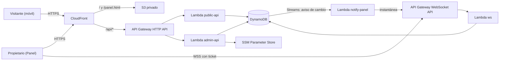

# Link in Bio

Página pública de enlaces tipo "Link in Bio" con un Panel del propietario que muestra métricas en tiempo real: clics por enlace, clics por minuto, canal de origen y feed de actividad.

Este repositorio es también una **demo de desarrollo dirigido por especificaciones** (spec-driven development) con [Kiro](https://kiro.dev): cada fase del proceso vive en su propia rama y está documentada en [`docs/`](docs/).

> Momento clave de la demo: el público escanea un QR, abre la página en el móvil, pulsa un enlace y ve en pantalla cómo sube el contador, cómo aparece el pico en la gráfica por minuto y cómo se mueve el feed de actividad.

## Características

- **Página pública** (`/`): lista de enlaces, selector de tema, mobile first y menos de 30 KB comprimida.
- **Panel del propietario** (`/panel.html`): totales, gráfica por minuto, canales de origen, feed de actividad y gestión de enlaces (crear, editar, activar/desactivar, eliminar y reordenar).
- **Tiempo real** por WebSocket, con un plazo objetivo de 1 s y máximo de 3 s desde el clic hasta el Panel.
- **Canal de origen** con el parámetro `?src=` en la URL pública (10 canales predefinidos, `directo` si no hay `src` y `otro` para cualquier valor desconocido).
- **Privacidad por construcción**: solo contadores agregados. Sin IPs, User-Agent, Referer, cookies ni almacenamiento local en la página pública.
- **Acceso sin usuarios**: el Panel se protege con un token secreto guardado en SSM Parameter Store.
- **Robusto ante picos**: probado para 500 clics en 10 s.

## Arquitectura

AWS serverless, definida por completo con AWS CDK v2 en `us-east-1`.



- Cada clic o visita suma todos sus contadores con un único `UpdateItem` con `ADD` atómico sobre el elemento `METRICS/CURRENT`.
- DynamoDB Streams avisa a `notify-panel`, que envía la instantánea actual a todos los Paneles conectados (como máximo un mensaje por segundo).
- El Panel abre el WebSocket con un ticket de un solo uso (60 s). El token del propietario nunca viaja en una URL.
- CloudFront sirve la web y la API en el mismo dominio, así que no hace falta CORS.

El diseño completo, con las decisiones D1 a D17, está en [`.kiro/specs/link-in-bio/design.md`](.kiro/specs/link-in-bio/design.md).

### API

| Ruta                                    | Acceso  | Uso                                             |
| --------------------------------------- | ------- | ----------------------------------------------- |
| `GET /api/links`                        | Público | Lista de enlaces activos                        |
| `POST /api/visits`                      | Público | Registrar una visita                            |
| `POST /api/clicks`                      | Público | Registrar un clic                               |
| `POST /api/admin/realtime-tickets`      | Token   | Obtener un ticket y la URL del WebSocket        |
| `GET /api/admin/metrics`                | Token   | Instantánea de las métricas                     |
| `POST /api/admin/metrics/reset`         | Token   | Reiniciar las métricas                          |
| `GET`, `POST /api/admin/links`          | Token   | Listar y crear enlaces                          |
| `PATCH`, `DELETE /api/admin/links/{id}` | Token   | Editar, activar/desactivar y eliminar un enlace |
| `PUT /api/admin/links/order`            | Token   | Reordenar los enlaces                           |

Las rutas de administración esperan el token en la cabecera `Authorization`.

## Stack

- TypeScript `strict` en todo el proyecto, npm workspaces.
- Node.js 24 (runtime `nodejs24.x` en Lambda).
- Frontend: Vite + TypeScript, sin framework.
- Backend: AWS Lambda, AWS SDK for JavaScript v3, Zod para validación.
- Infraestructura: AWS CDK v2 (CloudFront, S3, API Gateway HTTP y WebSocket, Lambda, DynamoDB on-demand, SSM).
- Calidad: Vitest, `fast-check` (tests de propiedades), `happy-dom`, ESLint y Prettier.

## Estructura

```
.
├── .kiro/          # Steering, spec (requisitos EARS, diseño, tareas) y hooks de Kiro
├── docs/           # Guía de la demo: un archivo por fase
├── shared/         # Contratos compartidos: esquemas Zod, canales, mensajes de tiempo real
├── frontend/       # Página pública (src/public) y Panel (src/dashboard)
├── backend/        # Lambdas: handlers finos, dominio puro y adaptadores de AWS
│   └── src/dev/    # Servidor local de desarrollo (en memoria, sin AWS)
└── infra/          # Stack de CDK y scripts de humo, calentamiento y carga
```

El backend sigue una arquitectura hexagonal: `backend/src/lib/domain/` no importa nada de AWS y define puertos que implementan los adaptadores de `backend/src/lib/adapters/`. Detalle en [`.kiro/steering/structure.md`](.kiro/steering/structure.md).

## Requisitos previos

- Node.js 24 (ver [`.nvmrc`](.nvmrc)) y npm.
- Para desplegar: una cuenta de AWS y la AWS CLI v2 con sesión iniciada en `us-east-1`.

## Desarrollo local

El servidor local ejecuta los handlers reales sobre dobles en memoria. No necesita AWS y los datos se pierden al pararlo.

1. Instala las dependencias:

   ```bash
   npm install
   ```

2. Copia `.env.example` como `.env`:

   ```bash
   cp .env.example .env
   ```

3. Genera un token de desarrollo (32 caracteres o más) y ponlo en `LOCAL_OWNER_TOKEN` dentro de `.env`:

   ```bash
   node -e "console.log(require('node:crypto').randomBytes(24).toString('base64url'))"
   ```

4. Arranca la API y la web:

   ```bash
   npm run dev
   ```

5. Abre:
   - Página pública: <http://localhost:5173/> (prueba un canal con <http://localhost:5173/?src=qr>).
   - Panel: <http://localhost:5173/panel.html>, entrando con el token de `.env`.

Variables opcionales en `.env`: `PORT` (puerto de la API, por defecto `8787`) y `LOCAL_WS_URL` (URL del WebSocket que recibe el Panel, por defecto a través del proxy de Vite).

## Scripts

| Comando             | Qué hace                                                |
| ------------------- | ------------------------------------------------------- |
| `npm run dev`       | API local en memoria y Vite con proxy de `/api` y `/ws` |
| `npm run build`     | Compila TypeScript y genera `frontend/dist`             |
| `npm test`          | Ejecuta todos los tests con Vitest (`vitest --run`)     |
| `npm run lint`      | ESLint y comprobación de formato con Prettier           |
| `npm run format`    | Formatea el código con Prettier                         |
| `npm run smoke`     | Prueba de humo de solo lectura contra un despliegue     |
| `npm run warm-up`   | Calienta las Lambdas antes de una demo o de la carga    |
| `npm run load-test` | Prueba de carga contra un despliegue (ver abajo)        |

## Despliegue en AWS

El despliegue crea recursos con coste en tu cuenta. Revisa `cdk diff` antes de desplegar. La guía completa, con resultados y lecciones aprendidas, está en [`docs/fase-5-deployment.md`](docs/fase-5-deployment.md).

1. Comprueba la cuenta a la que apunta la AWS CLI:

   ```bash
   aws sts get-caller-identity
   ```

2. Inicializa CDK en la cuenta y la Región (una sola vez), desde `infra/`:

   ```bash
   npx cdk bootstrap aws://<ACCOUNT_ID>/us-east-1
   ```

3. Crea el token del Panel en SSM Parameter Store como `SecureString` (32 caracteres o más). CDK solo lo referencia, no lo crea:

   ```bash
   aws ssm put-parameter --region us-east-1 --name /link-in-bio/owner-token --type SecureString --value "<tu-token>"
   ```

4. Compila el proyecto desde la raíz (el stack sube `frontend/dist`):

   ```bash
   npm run build
   ```

5. Revisa y despliega desde `infra/`:

   ```bash
   npx cdk diff && npx cdk deploy
   ```

6. Comprueba el despliegue desde la raíz con la `SiteUrl` que imprime CDK:

   ```bash
   LOAD_TEST_API_URL=https://xxxx.cloudfront.net npm run smoke
   ```

Los ejemplos con variables de entorno usan la sintaxis de bash. En PowerShell, defínelas antes:

```powershell
$env:LOAD_TEST_API_URL = "https://xxxx.cloudfront.net"
npm run smoke
```

Al terminar, el stack `LinkInBioStack` muestra dos salidas: `SiteUrl` (URL de CloudFront) y `WebSocketUrl`.

Para borrar todo el stack, desde `infra/`:

```bash
npx cdk destroy
```

## Prueba de carga

Envía 500 clics en 10 s mientras escucha el WebSocket como lo hace el Panel, y después 500 visitas. Comprueba los contadores, el p95 de las respuestas y el p95 hasta el mensaje en tiempo real.

Calienta antes las Lambdas: una cuenta nueva suele tener un límite de 10 ejecuciones concurrentes, y con las funciones frías algunos clics se rechazan.

```bash
LOAD_TEST_API_URL=https://xxxx.cloudfront.net LOAD_TEST_TOKEN=<token> npm run warm-up
```

```bash
LOAD_TEST_API_URL=https://xxxx.cloudfront.net LOAD_TEST_TOKEN=<token> npm run load-test
```

Modifica los contadores reales de la app: úsala contra un despliegue de pruebas y sin otros visitantes. Después, usa "Reiniciar métricas" en el Panel.

## Fases de la demo

Cada fase tiene su rama y su guía. **Cada rama contiene la fase ya completada**: `fase-2-design` tiene el diseño terminado, no el punto de partida para hacerlo.

| Fase                 | Rama (fase completada)  | Guía                                                             |
| -------------------- | ----------------------- | ---------------------------------------------------------------- |
| 0. Steering          | `fase-0-steering`       | [`docs/fase-0-steering.md`](docs/fase-0-steering.md)             |
| 1. Requisitos (EARS) | `fase-1-requirements`   | [`docs/fase-1-requirements.md`](docs/fase-1-requirements.md)     |
| 2. Diseño            | `fase-2-design`         | [`docs/fase-2-design.md`](docs/fase-2-design.md)                 |
| 3. Tareas            | `fase-3-tasks`          | [`docs/fase-3-tasks.md`](docs/fase-3-tasks.md)                   |
| 4. Implementación    | `fase-4-implementacion` | [`docs/fase-4-implementation.md`](docs/fase-4-implementation.md) |
| 5. Despliegue        | `fase-5-deployment`     | [`docs/fase-5-deployment.md`](docs/fase-5-deployment.md)         |

### Cómo replicar una fase

Para replicar una fase, parte de la rama de la **fase anterior**, que es la que deja todo listo para empezar. Al terminar, compara tu resultado con la rama de la fase que acabas de replicar.

| Para replicar        | Parte de                | Compara con             |
| -------------------- | ----------------------- | ----------------------- |
| 0. Steering          | Un repositorio vacío    | `fase-0-steering`       |
| 1. Requisitos (EARS) | `fase-0-steering`       | `fase-1-requirements`   |
| 2. Diseño            | `fase-1-requirements`   | `fase-2-design`         |
| 3. Tareas            | `fase-2-design`         | `fase-3-tasks`          |
| 4. Implementación    | `fase-3-tasks`          | `fase-4-implementacion` |
| 5. Despliegue        | `fase-4-implementacion` | `fase-5-deployment`     |

Ejemplo: replicar la fase 2 (diseño).

1. Clona el repositorio y trae todas las ramas:

   ```bash
   git clone https://github.com/PalaciosLuisMig/demo-ssd-kiro.git && cd demo-ssd-kiro
   ```

2. Crea la rama de la fase a partir de la fase anterior (la 1, ya completada). Es el paso 1 de la guía de la fase:

   ```bash
   git switch -c fase-2-design origin/fase-1-requirements
   ```

3. Sigue el resto de la sección "Cómo reproducir esta fase" de [`docs/fase-2-design.md`](docs/fase-2-design.md) con Kiro. Léela en `main` o en GitHub: la rama de la fase anterior todavía no tiene la guía de la fase que vas a replicar.

4. Compara tu rama local con la fase 2 de referencia, que sigue en `origin`:

   ```bash
   git diff fase-2-design origin/fase-2-design -- .kiro/
   ```

Para la fase 0 no hay fase anterior: empieza en un repositorio vacío (`git init`) y crea el steering desde cero.

Si solo quieres ver el resultado de una fase, sin replicarla, cámbiate a su rama: `git switch fase-4-implementacion`. La app completa, con todas las fases, está en `main`.

La spec completa está en [`.kiro/specs/link-in-bio/`](.kiro/specs/link-in-bio/): `requirements.md`, `design.md` y `tasks.md`.

## Convenciones

- Código, nombres y comentarios en inglés. Interfaz y documentación en español.
- Commits con [Conventional Commits](https://www.conventionalcommits.org/) y ámbito: `tipo(ámbito): descripción`.
- Una tarea está terminada solo cuando compila, pasa lint y pasa tests.
