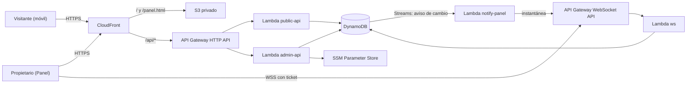

# Fase 2: Diseño

Rama: `fase-2-design`

## Qué es esta fase
Se decide cómo se construye lo que piden los requisitos: componentes de AWS, flujos, modelo de datos, contratos entre frontend y backend, capas del código y estrategia de tests. El resultado es `.kiro/specs/link-in-bio/design.md`. No se escribe código todavía; eso empieza en la fase de tareas.

El diseño sigue el steering (`product.md`, `tech.md`, `structure.md`), cubre los 17 requisitos de `requirements.md` y cierra los puntos que el steering y la fase 1 dejaron pendientes. Es una versión "lite", pensada para una demo de nivel principiante a intermedio: pocas piezas, cada una con una función clara y sin mecanismos que solo hacen falta a gran escala.

## Archivos de esta fase

| Archivo | Contenido |
|---|---|
| `.kiro/specs/link-in-bio/design.md` | Nuevo. Visión general, 17 decisiones de diseño, arquitectura, componentes e interfaces, modelo de datos, 18 propiedades de corrección, manejo de errores, estrategia de tests, riesgos, extensión prevista y trazabilidad con los requisitos |
| `docs/fase-2-design.md` | Esta guía |

Al revisar el diseño también cambiaron dos documentos de fases anteriores. Se versionaron en su propia rama y ya están en `main`:

| Archivo | Rama y PR | Cambio |
|---|---|---|
| `.kiro/steering/structure.md` | `fase-0-steering` (PR #2) | La carpeta `backend/src/lib/repositories/` pasa a llamarse `adapters/` |
| `.kiro/specs/link-in-bio/requirements.md` | `fase-1-requirements` (PR #3) | Canales cerrados (requisito 4), plazo de tiempo real de 3 s, época de métricas y mensaje único de instantánea |

## Arquitectura en una frase
CloudFront sirve la web y la API en el mismo dominio. Cada Clic o Visita suma sus contadores con una única operación atómica sobre un elemento de DynamoDB, y DynamoDB Streams avisa a una Lambda que envía el estado actual al Panel por WebSocket.



## Componentes

| Componente | Función |
|---|---|
| CloudFront + S3 | Sirve la página pública (`/`) y el Panel (`/panel.html`) desde un bucket privado, y reenvía `/api/*` a la HTTP API sin cachear |
| HTTP API | Rutas públicas (`/api/links`, `/api/visits`, `/api/clicks`) y de administración (`/api/admin/*`), con throttling por ruta |
| Lambda `public-api` | Lista los Enlaces activos y registra Visitas y Clics |
| Lambda `admin-api` | Gestiona Enlaces, devuelve y reinicia las Métricas y emite Tickets_Conexión. Valida el token contra SSM |
| WebSocket API + Lambda `ws` | Una sola Lambda atiende `$connect` (consume el ticket), `$disconnect` y `$default` (solo acepta `keepalive`) |
| Lambda `notify-panel` | Recibe el aviso de Streams, lee el estado actual y envía la instantánea a todos los Paneles conectados |
| DynamoDB | Tabla única `LinkInBioTable` en modo on-demand, con TTL y stream |
| SSM Parameter Store | Guarda el Token_Propietario como `SecureString` |

## Una demo lite
El primer borrador del diseño usaba un procesador de Streams que contaba los clics por lotes, con marcas de idempotencia, transacciones y turnos de envío. Era correcto, pero demasiado para una demo de nivel principiante a intermedio. Como los canales son una lista cerrada, todos los contadores caben en un solo elemento de DynamoDB y basta una operación atómica.

| | Borrador inicial | Versión lite |
|---|---|---|
| Contar un Clic | El handler guarda un evento y un procesador de Streams cuenta por lotes | Un `UpdateItem` con `ADD` sobre el elemento `METRICS/CURRENT` |
| Papel de Streams | Contar, reservar turno y difundir | Solo avisar de que algo cambió |
| Mensajes en tiempo real | `metrics` y `reset` | Un único mensaje `snapshot`, el mismo formato que devuelve la API |
| Reiniciar métricas | Época en la clave de cada contador | Reemplazar el elemento `METRICS/CURRENT` con una época nueva |
| Tipos de elemento en DynamoDB | 12 | 5 |
| Lambdas | 6 | 4 |
| Puertos del dominio | 12 | 6, más `Clock`, `IdGenerator`, `RandomSource` y `Logger` |
| Propiedades de corrección | 23 | 18 |
| Dependencias nuevas | `zod`, `fast-check`, `aws-sdk-client-mock`, `happy-dom` | `zod` y `fast-check` |
| Canales personalizados | Incluidos | Fuera de esta versión, para la demo en vivo |

## Decisiones de diseño
El detalle y las alternativas descartadas están en la tabla D1 a D17 de `design.md`.

| Id | Decisión |
|---|---|
| D1 | Todos los contadores en un único elemento, incrementados con un `UpdateItem` con `ADD` por Clic o Visita. O se suman todos o ninguno, y la lectura siempre es coherente |
| D2 | Tabla única `LinkInBioTable` con claves `pk` y `sk`, con 5 tipos de elemento |
| D3 | Mismo origen: CloudFront sirve la API en `/api/*`, así que no hace falta CORS |
| D4 | El WebSocket se abre directamente contra API Gateway, sin pasar por CloudFront |
| D5 | Ticket de un solo uso (60 s) en la URL del WebSocket. El Token_Propietario nunca aparece en una URL |
| D6 | Zod para los esquemas de `shared/` |
| D7 | Un único stack de CDK con cuatro constructs: `Storage`, `Api`, `Realtime` y `Frontend` |
| D8 | Streams solo como aviso (vista `KEYS_ONLY`, filtrado por `METRICS` y `EVENTS`). Una pausa de 1 s al final de cada invocación asegura como máximo un mensaje por segundo |
| D9 | Throttling por ruta: 150 req/s (ráfaga 300) para clics y 50 req/s (ráfaga 100) para visitas. Sin límite por IP, porque el público comparte la Wi-Fi |
| D10 | Frontend en TypeScript sin framework. El estado del Panel es un reductor puro |
| D11 | Los adaptadores que usan el SDK de AWS viven en `backend/src/lib/adapters/` |
| D12 | Canales cerrados: 10 Canales_Predefinidos. Sin `src` es `directo` y cualquier otro valor es `otro` |
| D13 | La API decide el Canal_Origen. La página solo envía el valor de `src` tal cual |
| D14 | Plazo de tiempo real de 1 a 3 s: objetivo habitual de 1 s y máximo de 3 s |
| D15 | Dependencias: `zod` (producción) y `fast-check` (desarrollo). `aws-sdk-client-mock` y `happy-dom` están aprobadas, pero solo se instalan si hacen falta |
| D16 | El Panel se sirve en `/panel.html`, y la URL del WebSocket viaja en la respuesta del ticket. No hacen falta una CloudFront Function ni un `config.json` |
| D17 | La época es la hora (ms) del último reinicio, o 0 si nunca se ha reiniciado. No hay que leer antes de reiniciar y sirve de límite para leer el feed |

## Modelo de datos
Una sola tabla con 5 tipos de elemento:

| `pk` | `sk` | Uso | Caducidad |
|---|---|---|---|
| `LINKS` | `LINK#<id>` | Enlaces (como máximo 10) | No |
| `METRICS` | `CURRENT` | Todos los contadores de la época en curso | No |
| `EVENTS` | `<ts en ms>#<id>` | Entradas del Feed_Actividad | 24 h |
| `CONN` | `<connectionId>` | Conexiones del Panel | 24 h |
| `TICKET` | `<SHA-256 del ticket>` | Tickets_Conexión pendientes de uso | 1 h tras caducar |

El elemento `METRICS/CURRENT` guarda cada contador como un atributo propio. Un `ADD` sobre un atributo que no existe lo crea, así que no hay que inicializar nada:

```
Clic:   ADD totalClicks 1, l#<linkId> 1, cc#<canal> 1, m#<inicio del Minuto> 1
Visita: ADD totalVisits 1, cv#<canal> 1
```

- **Reiniciar** es un `PutItem` que sustituye el elemento por uno vacío con la época nueva. Los eventos anteriores dejan de leerse porque el feed solo lee eventos posteriores a la época.
- **Eliminar un Enlace** borra el Enlace y su atributo `l#<id>`. El total, los Minutos y los canales conservan sus Clics.
- **Privacidad por construcción:** no existe ningún campo para IP, User-Agent ni Referer.
- **Carga en el pico:** 500 Clics en 10 s son 50 escrituras por segundo sobre el elemento, por debajo del límite de 1 000 por segundo de una partición.

## API
| Ruta | Acceso | Uso |
|---|---|---|
| `GET /api/links` | Público | Lista de Enlaces activos |
| `POST /api/visits` | Público | Registrar una Visita |
| `POST /api/clicks` | Público | Registrar un Clic |
| `POST /api/admin/realtime-tickets` | Token | Obtener un ticket y la URL del WebSocket |
| `GET /api/admin/metrics` | Token | Instantánea de las Métricas |
| `POST /api/admin/metrics/reset` | Token | Reiniciar las Métricas |
| `GET`, `POST /api/admin/links` | Token | Listar y crear Enlaces |
| `PATCH`, `DELETE /api/admin/links/{id}` | Token | Editar, activar o desactivar y eliminar un Enlace |
| `PUT /api/admin/links/order` | Token | Reordenar los Enlaces |

Todas las peticiones pasan por la misma canalización, en este orden: tamaño del cuerpo, token (solo en administración), JSON y esquema. Así, una petición sin token válido recibe 401 sin que se revele el formato de la API. Todas las respuestas llevan `Cache-Control: no-store`.

## Tiempo real
1. El Panel pide un ticket a la API y abre el WebSocket con él. El ticket se consume de forma atómica y no se puede reutilizar.
2. Cada Clic o Visita modifica `METRICS` y `EVENTS`, y DynamoDB Streams avisa a `notify-panel`.
3. `notify-panel` lee el estado actual, envía la instantánea a todas las Conexiones y espera hasta completar 1 s.
4. El Panel aplica la instantánea con un reductor puro que conserva el valor mayor de cada contador y descarta las de una época anterior. Un reinicio llega como una instantánea de época nueva.
5. El Panel envía un `keepalive` cada 5 minutos, porque API Gateway cierra un WebSocket tras 10 minutos sin tráfico, y vuelve a pedir las Métricas cada 30 s por si se pierde algún mensaje.
6. Si se corta la conexión, reintenta con espera exponencial (1, 2, 4, 8, 16 y hasta 30 s), con un ticket nuevo en cada intento.

Latencia estimada de un Clic hasta el Panel: entre 0,5 y 1,5 s habitualmente y menos de 3 s en el peor caso. Es un cálculo; la prueba de carga debe confirmarlo.

## Arquitectura del código
Arquitectura hexagonal: las dependencias apuntan hacia el dominio, que no importa nada de AWS.

| Capa | Carpeta | Contenido |
|---|---|---|
| Contratos | `shared/src/` | `PREDEFINED_CHANNELS`, `normalizeChannel`, `validateTitle`, `validateUrl`, esquemas Zod y mensajes de tiempo real |
| Adaptadores de entrada | `backend/src/handlers/` | `http/`, `websocket/` y `streams/`. Solo parsean, llaman al caso de uso y responden |
| Dominio | `backend/src/lib/domain/` | Casos de uso, puertos y funciones puras |
| Adaptadores de salida | `backend/src/lib/adapters/` | DynamoDB, SSM y API Gateway Management |
| Frontend | `frontend/src/` | `public/` (página pública), `dashboard/` (Panel) y `lib/` (clientes de la API y del WebSocket) |
| Infraestructura | `infra/lib/` | Constructs de CDK |

Puertos del dominio: `LinkRepository`, `MetricsRepository`, `EventRepository`, `RealtimeAccessRepository`, `OwnerTokenProvider` y `RealtimeNotifier`, más `Clock` (con `now` y `sleep`), `IdGenerator`, `RandomSource` y `Logger` (único punto con `console`). `design.md` relaciona cada principio SOLID con una decisión concreta.

## Seguridad
- Token_Propietario de al menos 32 caracteres en SSM `SecureString`, enviado en la cabecera `Authorization` y comparado en tiempo constante.
- Ticket de un solo uso para el WebSocket, del que solo se guarda el hash SHA-256.
- Ni el token ni el ticket se escriben en los registros ni en las respuestas de error.
- HTTPS obligatorio, CSP, HSTS, `nosniff`, `Referrer-Policy` y `noindex` en el Panel.
- Registros de acceso de CloudFront y del WebSocket desactivados para no guardar IPs.
- IAM de mínimo privilegio por Lambda, sin `*` en acciones ni recursos.

## Calidad y tests
Las 18 propiedades de corrección se prueban con `fast-check` (mínimo 100 ejecuciones cada una):

| Ámbito | Propiedades |
|---|---|
| Canal de origen | 1. Normalización del canal |
| Métricas | 2. Conservación de los incrementos, 3. Lectura del elemento de métricas, 4. Reinicio |
| Enlaces | 5. Lista pública, 6. Límite de Enlaces e identificadores únicos, 7. Reordenación, 8. Validación de título y URL, 9. Eliminar un Enlace conserva el histórico |
| Panel | 10. Reductor (monotonía, idempotencia y conmutatividad), 11. Épocas distintas, 12. Ventana de 60 Minutos, 13. Feed de actividad |
| Contratos y conexión | 14. Ida y vuelta de los mensajes, 15. Espera de reconexión, 16. Tickets de un solo uso, 17. Autorización |
| Privacidad | 18. Solo se guardan datos permitidos |

Además hay tests de unidad para los casos borde, tests de los casos de uso con dobles en memoria (sin AWS), tests de infraestructura con `aws-cdk-lib/assertions`, una prueba de humo tras el despliegue y una prueba de carga con 500 Clics en 10 s. El contraste, el tiempo de carga con Fast 3G y el uso con lector de pantalla se verifican a mano.

## Riesgos aceptados
| Id | Riesgo | Decisión |
|---|---|---|
| R1 | El elemento `METRICS` crece un atributo por cada Minuto con Clics | Reiniciar las métricas antes de la demo |
| R2 | La pausa de 1 s asume un único shard de Streams | Aceptarlo: con este tráfico hay un solo shard, y las instantáneas absolutas siguen siendo correctas |
| R3 | El evento del feed es de mejor esfuerzo | Aceptarlo: los contadores son la fuente de verdad |
| R4 | Dos altas simultáneas podrían dejar 11 Enlaces | Aceptarlo: solo hay un Propietario |
| R5 | El token se crea fuera de CDK | Comando documentado más abajo |
| R6 | El endpoint `execute-api` sigue accesible sin pasar por CloudFront | Aceptarlo: el throttling y la autenticación aplican igual |
| R7 | El arranque en frío de Lambda en la carga de 2 s | Paquete mínimo con esbuild y ARM64, y medir con la función caliente |
| R8 | Un Panel con un token ya rotado sigue recibiendo mensajes hasta cerrar su Conexión | Aceptarlo: la siguiente petición HTTP responde 401 |
| R9 | Cambiar los Canales_Predefinidos requiere desplegar | Aceptarlo: el spec de canales personalizados lo resuelve |

## Extensión para la demo en vivo: canales personalizados
Los canales que añade el Propietario desde el Panel se construirán en directo, creando un spec nuevo. El diseño ya deja los puntos de extensión (sección "Extensión prevista" de `design.md`):

- `normalizeChannel(value)` recibirá un segundo parámetro con la lista de canales personalizados.
- La lista se guardará en un elemento nuevo de la tabla (por ejemplo `CONFIG/CHANNELS`), con un puerto `ChannelRepository` y sus rutas de administración.
- `registerClick` y `registerVisit` leerán esa lista antes de normalizar el canal.
- Los contadores `cc#<canal>` y `cv#<canal>` ya admiten cualquier nombre, así que el modelo de métricas no cambia.
- El spec nuevo debe fijar un máximo de canales personalizados, porque acota el número de contadores y el tamaño del elemento `METRICS`.
- Una idea para el Panel: mostrar la URL de cada canal con el parámetro `src` y un botón para copiarla.

## Pendiente para la fase 3 (tareas)
- Dividir el diseño en tareas pequeñas y ordenadas, con sus tests y los requisitos que cubre cada una.
- Crear el monorepo con los cuatro workspaces y las herramientas de calidad (TypeScript `strict`, ESLint, Prettier y Vitest).

## Preparación antes de desplegar (fase 6)
CloudFormation no puede crear parámetros `SecureString`, así que el token del panel se crea una vez a mano. El valor debe tener al menos 32 caracteres aleatorios y no se guarda en el repositorio:

```powershell
$token = [Convert]::ToBase64String([Security.Cryptography.RandomNumberGenerator]::GetBytes(32))
aws ssm put-parameter --name "/link-in-bio/owner-token" --type SecureString --value $token --region eu-west-1
```

## Cómo reproducir esta fase
1. Actualiza `main` y crea la rama: `git checkout main`, `git pull` y `git checkout -b fase-2-design`.
2. En el spec de Kiro, pide crear el diseño a partir de los requisitos aprobados.
3. Revisa con Kiro las decisiones de diseño y los riesgos, y simplifica lo que no haga falta para el nivel de la demo.
4. Si una decisión cambia los requisitos o el steering, versiona ese cambio en la rama de su fase y llévalo a `main` con su propia PR.
5. Comprueba que cada requisito aparece en la tabla de trazabilidad del diseño.
6. Haz el commit: `docs(specs): add link-in-bio design`.
